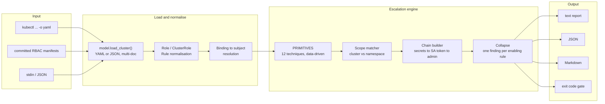
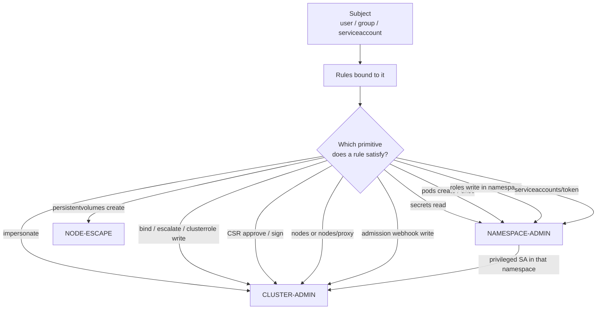

# rbacpath

**Offline Kubernetes RBAC privilege-escalation path finder.**
Point it at an RBAC export and it tells you which subjects can reach cluster-admin,
which rule unlocks each step, and what to fix.

[](#installation)
[](https://www.python.org)
[](#design-choices)
[](#testing)
[](LICENSE)
[](#threat-model)

---

## The problem

Kubernetes RBAC is additive and indirect. A ServiceAccount gets a Role through a
RoleBinding; that Role allows `create` on `pods`; one of those pods can mount a
different ServiceAccount token; that account can `impersonate` a user; and suddenly
a CI job in `staging` owns the cluster.

No single binding looks wrong. `kubectl auth can-i` answers per-verb questions and
will happily tell you "yes" or "no" without showing the chain, and it needs live
cluster access to answer at all. Reviewing a 4,000-line RBAC dump by hand is where
this class of finding goes to die.

`rbacpath` answers the composed question instead: **given everything bound to this
subject, what can it ultimately become, and through which rule?**

```text
$ rbacpath cluster.yaml

CRITICAL serviceaccount:staging/ci-deployer
------------------------------------------------------------
  [CLUSTER-ADMIN] cluster_admin (cluster-wide) severity=CRITICAL confidence=high
    why: Can act as a more privileged identity.
    1. Can impersonate users, groups or service accounts
       rule:   impersonate on users,groups,serviceaccounts
               in ClusterRole/identity-switcher
               via ClusterRoleBinding/ci-deployer-impersonate
       scope:  cluster-wide
```

A CI deployer in `staging` holding `impersonate` is cluster-admin. That single line
is the finding, with the binding that created it.

---

## Why this exists

RBAC escalation review is usually done in one of three ways, all with a gap:

| Approach | Gap |
| --- | --- |
| `kubectl auth can-i --list` | Per-subject, per-verb. No chains, no severity, needs cluster access. |
| Manual review of `kubectl get clusterrole -o yaml` | Does not scale, misses multi-hop paths, no repeatable gate. |
| `kube-hunter` / `kube-bench` style scanners | Audit the *node and control plane config*, not the permission graph. |

`rbacpath` is deliberately narrow: **RBAC objects only**. No API calls, no
credentials, no cluster connectivity, no false confidence from a partial live read.
It is safe to run in an air-gapped review, in CI against a committed manifest
export, or on a laptop against a customer's audit dump.

---

## Architecture



### The primitive model

Every technique is a data record, not bespoke logic. This is the whole reason the
engine is auditable enough to trust in a security review:

```python
Primitive(
    id="sa-token-mint",
    title="Can mint ServiceAccount tokens",
    severity="HIGH",
    confidence="high",
    yields="namespace",
    checks=(({"create"}, {"serviceaccounts/token"}),),
    note="TokenRequest on serviceaccounts/token issues a valid bearer token "
         "for any ServiceAccount in the namespace.",
)
```

Adding a technique means adding a record. The rule set, the severities and the
explanations all live in one table that a reviewer can read top to bottom.

### The hop graph



That last edge is the one humans miss. Reading Secrets is often triaged as
"information disclosure, medium". If the namespace also holds a ServiceAccount
bound to cluster-admin, it is credential theft straight to cluster takeover, and
`rbacpath` reports it as a two-hop path with `confidence=medium`.

---

## What it detects

Twelve primitives, each mapped to what it actually yields:

| Primitive | Needs | Yields | Severity |
| --- | --- | --- | --- |
| `rbac-write-cluster` | write on `clusterroles` / `clusterrolebindings` | cluster-admin | CRITICAL |
| `bind-escalate` | `bind` / `escalate` on roles | cluster-admin | CRITICAL |
| `impersonate` | `impersonate` on users / groups / serviceaccounts | cluster-admin | CRITICAL |
| `csr-approve` | `approve` / `sign` on `certificatesigningrequests` | cluster-admin | CRITICAL |
| `node-access` | read/write on `nodes`, `nodes/proxy`, `nodes/exec` | cluster-admin | CRITICAL |
| `admission-webhook` | write on `mutatingwebhookconfigurations` | cluster-admin | CRITICAL |
| `rbac-write-ns` | write on `roles` / `rolebindings` in a namespace | namespace takeover | HIGH |
| `secrets-read` | `get` / `list` / `watch` on `secrets` | credential theft | HIGH |
| `pod-create` | `create` on pods or workload controllers | code exec as any SA | HIGH |
| `pod-exec` | `create` / `get` on `pods/exec`, `pods/attach` | code exec in a pod | HIGH |
| `sa-token-mint` | `create` on `serviceaccounts/token` | any SA identity | HIGH |
| `persistent-volume` | `create` on `persistentvolumes` | node filesystem | HIGH |

**Scope is respected.** A namespace-scoped grant never satisfies a cluster-wide
question, while a cluster-wide grant does satisfy a namespace question. `pods/*`
covers `pods/exec`. `resourceNames` restrictions are surfaced in the finding rather
than silently ignored, because a `secrets` rule limited to one name is a different
risk from an unrestricted one.

---

## Installation

Zero runtime dependencies for JSON input. YAML needs PyYAML.

```bash
# from source
git clone https://github.com/mehulpatel23b-pixel/rbacpath.git
cd rbacpath
pip install -e ".[yaml]"

# or just run it without installing
PYTHONPATH=src python3 -m rbacpath.cli cluster.yaml
```

Python 3.9+.

---

## Usage

### Export the RBAC you want to review

```bash
kubectl get role,rolebinding,clusterrole,clusterrolebinding,serviceaccount \
  -A -o yaml > cluster.yaml
```

That is a read-only `get`. `rbacpath` never talks to the API server itself.

### Scan everything

```bash
rbacpath cluster.yaml
```

Every subject that appears in a binding is analysed and sorted by severity.

### Scan one subject

```bash
rbacpath cluster.yaml --subject sa:prod/api-sa
rbacpath cluster.yaml --subject group:system:authenticated
rbacpath cluster.yaml --subject user:alice@example.com
```

### Pipe it

```bash
kubectl get role,rolebinding,clusterrole,clusterrolebinding -A -o yaml | rbacpath -
```

### Machine-readable output

```bash
rbacpath cluster.yaml --format json --subject sa:ci/deployer | jq '.subjects[0].findings'
```

```json
{
  "subject": "serviceaccount:staging/ci-deployer",
  "terminal": "cluster_admin",
  "scope": "cluster-wide",
  "severity": "CRITICAL",
  "confidence": "high",
  "summary": "Can act as a more privileged identity.",
  "hops": [
    {
      "primitive": "impersonate",
      "title": "Can impersonate users, groups or service accounts",
      "detail": "Impersonation inherits every permission of the target identity.",
      "scope": "cluster-wide",
      "role": "ClusterRole/identity-switcher",
      "binding": "ClusterRoleBinding/ci-deployer-impersonate",
      "rule": "impersonate on users,groups,serviceaccounts",
      "confidence": "high",
      "severity": "CRITICAL"
    }
  ]
}
```

Every hop carries `role`, `binding` and `rule`, so the finding is actionable
without re-opening the YAML.

### CI gate

```bash
# fail the pipeline on any finding
rbacpath cluster.yaml --fail-on any

# only fail on cluster-admin-class findings, warn on the rest
rbacpath cluster.yaml --fail-on critical --format markdown > rbac-report.md
```

| Exit code | Meaning |
| --- | --- |
| `0` | No findings at or above the `--fail-on` threshold |
| `2` | Findings at or above the threshold |
| `1` | Input error (unreadable file, malformed YAML, no RBAC objects) |

A `1` on malformed input is deliberate: a security gate that passes because it
could not parse the file is worse than no gate.

---

## Security use cases

**1. CI gate on RBAC manifests.** Review the golden manifests in the pipeline,
before they reach a cluster. Catch the `ClusterRoleBinding` that binds
`cluster-admin` to a `pusher` ServiceAccount in review, not in an incident
retrospective.

```yaml
- name: RBAC escalation gate
  run: |
    rbacpath rendered-rbac.yaml --fail-on critical
```

**2. Audit a live cluster's permission graph.** Export, then scan offline where
nobody can paste cluster credentials into a scanner:

```bash
kubectl get role,rolebinding,clusterrole,clusterrolebinding -A -o yaml \
  | rbacpath - --format markdown > rbac-review.md
```

**3. Blast-radius triage after a token leak.** A token was committed. Which
identity was it, and what could that identity have become?

```bash
rbacpath cluster.yaml --subject sa:prod/leaked-sa
```

**4. Namespace self-service review.** Platform teams hand out namespace admin.
Confirm that "admin in `team-a`" really is namespace-scoped and does not carry a
cluster-wide path:

```bash
rbacpath cluster.yaml --subject group:team-a-admins --format json
```

**5. Detection engineering.** Map report output to alerts. A subject that gains
`impersonate`, or a new `clusterrolebindings` write grant appearing between two
exports, is a high-signal change event. Compare JSON between runs.

---

## Threat model

**What it does:** statically composes permissions from RBAC objects you give it,
across multiple hops, and explains each hop.

**What it does not do:**

- It does not read admission controllers, OPA/Gatekeeper policy, or aggregated
  API servers. A role restricted by an admission webhook will still be reported;
  treat the output as the upper bound of what the RBAC grants.
- It does not model cloud IAM (EKS Pod Identity, GKE Workload Identity, Azure
  Workload Identity). A ServiceAccount with no cluster privileges can still own
  your cloud account. That is out of scope by design.
- It does not check for `default` ServiceAccount automount or PodSecurity
  admission. Run it alongside a workload-hardening scanner.
- Confidence is honest: `secrets-read` to cluster-admin is `medium`, because it
  requires that the namespace really holds a privileged SA token you can use.

**Handling real exports.** An RBAC dump is sensitive: it is a map of your
defence. Do not commit real cluster exports. `.gitignore` already excludes
`*.rbac.yaml`, `cluster-*.yaml` and generated `rbac-report.*` files; only
`examples/export.yaml` is tracked, and it is synthetic.

---

## Design choices

**Zero runtime dependencies.** JSON input needs only the standard library, so the
tool drops into any CI image without a dependency tree to audit. YAML support is
an opt-in extra.

**Data-driven primitives.** Techniques are records, not code paths. Reviewing the
rule set means reading one table.

**Collapse by rule.** A `*` on `*` rule technically satisfies most primitives and
every namespace primitive twice. Reporting all of it buries the finding. Findings
sharing an enabling rule collapse to the highest-impact outcome, so the report
stays readable without losing the rule that caused it.

**Explicit confidence.** Severity says how bad the outcome is. Confidence says how
certain the path is. `HIGH` severity with `medium` confidence is a real state and
should not be collapsed into a single scary number.

**Fail closed.** Unparseable input exits `1`, never `0`.

---

## Testing

```bash
pip install -e ".[dev]"
pytest
```

```text
98 passed
```

The suite covers subject parsing edge cases (`group:system:masters` vs
`system:master` must not match), wildcard and subresource semantics, cluster vs
namespace scope, service-account chaining in both directions, duplicate
collapsing, all three renderers, exit-code thresholds, and the CLI end to end
including stdin and malformed YAML.

---

## Example

`examples/export.yaml` is a small synthetic cluster with a deliberate mix:

| Subject | Outcome |
| --- | --- |
| `group:platform-admins` | cluster-admin via a wildcard binding |
| `user:alice@example.com` | cluster-admin, same binding |
| `serviceaccount:staging/ci-deployer` | cluster-admin via `impersonate` |
| `serviceaccount:prod/api-sa` | namespace admin via `secrets` read |
| `serviceaccount:prod/legacy-job` | namespace admin via Role/RoleBinding write |
| `serviceaccount:prod/builder` | no escalation path |
| `serviceaccount:staging/monitor` | no escalation path |

```bash
rbacpath examples/export.yaml
```

---

## Contributing

Adding a primitive is the most useful contribution: a new escalation technique
means one record in `PRIMITIVES`, one test in `tests/test_escalate.py`, and one
row in the detection table above. Keep `note` specific about *why* the permission
is dangerous, since that text is what ends up in someone's ticket.

## License

MIT. See [LICENSE](LICENSE).
